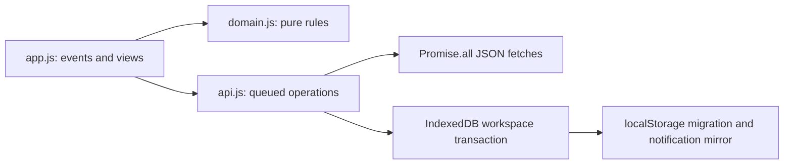
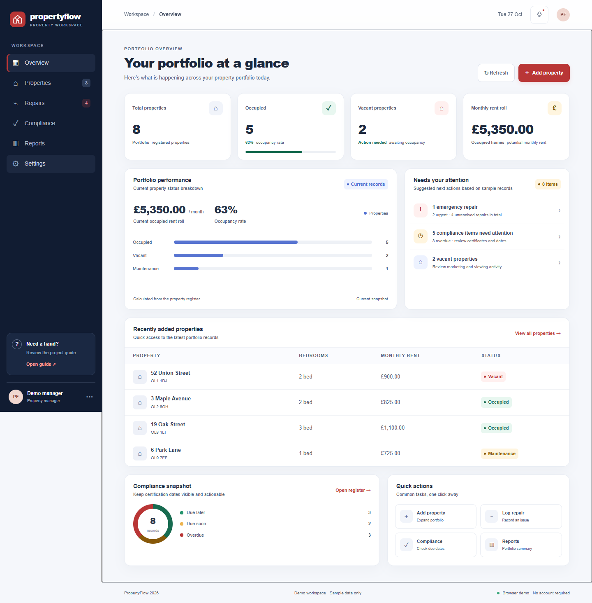

# PropertyFlow — Interactive Property Management Dashboard

**Level 5 Diploma in Web Application Development · Unit 2: Interactive Front End Development**

PropertyFlow is a responsive, framework-free educational prototype for a small UK property-management team. It connects a property register, maintenance workflow, certificate dates and portfolio reporting in one browser workspace.

**Status reviewed 27 October 2026. Live site:** [PropertyFlow](https://propertyflow-final.vercel.app), first published to alssl27’s Vercel account on 12 October 2026 and refreshed with the current IndexedDB revision on 27 October. The current revision passed 24 Node tests, 14 local Chrome tests, 14 deployed Chrome tests, 14 deployed Edge tests, five deployed colour/motion preference checks, 13 deployed HTTP/hash checks and the local plus official W3C validators. Real screenshots and initial failure/retest evidence are retained. Human accessibility checks and learner verification remain outstanding; the assessment has not been submitted.

## Purpose, users and goals

Fragmented spreadsheets and messages make vacancies, repairs and certificate dates hard to track. Managers need a portfolio summary; administrators need reliable records; maintenance coordinators need prioritised work. PropertyFlow links related records and calculates current totals, reducing repeated entry and giving users a clear next action. Its goal is to demonstrate significant custom JavaScript interaction, thoughtful UX, defensive programming and verifiable development evidence.

Use **fictional data only**. This app has no login, secure server, shared database, payment ledger or legal-compliance engine. Displayed rent is expected monthly rent, not collected income. Certificate dates support an educational workflow and do not establish legal compliance.

## Features and usage

- **Overview:** current property counts, occupancy percentage, occupied monthly rent, unresolved/emergency/urgent repairs, upcoming/overdue certificates, recent property additions and working shortcuts. All graphics derive from current records; no invented financial history.
- **Properties:** address/postcode/bedroom search, status filter and clear control, validated creation/editing, status changes, duplicate detection and confirmed deletion. Any linked repair or certificate blocks deletion; related records can be reassigned through Edit.
- **Repairs:** create/edit a property-linked issue, select Emergency/Urgent/Routine, combine priority/status filters and progress Open → Scheduled → In progress → Completed → Open. Existing status is changed through the explicit workflow control.
- **Compliance:** add/edit certificates, sort by expiry and filter by date-derived status. Overdue is before today; due soon includes today through 30 days ahead.
- **Reports:** occupancy/status mix, repair priorities, certificate summary, potential and occupied rent totals, plus escaped current-property CSV export with spreadsheet formula protection.
- **Settings:** explain storage and reset fictional records with confirmation. A failed reset preserves the existing saved snapshot.
- **Recovery:** loading, 15-second fetch timeout, meaningful errors, retry and reset recovery for corrupt saved data.

## User stories

| ID   | As a…                   | I want…                          | So that…                                  |
| ---- | ----------------------- | -------------------------------- | ----------------------------------------- |
| US01 | Manager                 | Accurate overview metrics        | I can prioritise work                     |
| US02 | Administrator           | Search and combined filters      | I can find the right record               |
| US03 | Administrator           | Validated add/edit/delete        | I can maintain accurate data              |
| US04 | Maintenance coordinator | Repair priorities and lifecycle  | I can track unresolved work               |
| US05 | Manager                 | Certificate dates and updates    | I can review upcoming tasks               |
| US06 | Manager                 | Summaries and CSV export         | I can analyse the current register        |
| US07 | Demo user               | Persistence and controlled reset | I can explore without losing control      |
| US08 | Mobile user             | Responsive navigation and forms  | I can work on a small screen              |
| US09 | Keyboard user           | Labels, focus and announcements  | I can operate without a mouse             |
| US10 | User                    | Honest errors and recovery       | I can recover from failed data operations |

Acceptance criteria appear in [UX design](docs/ux-design.md), with [screenshot mapping](docs/evidence-checklist.md).

## Run locally

1. Open this folder in VS Code.
2. With Node 24+ installed, run `npm start`.
3. Open http://127.0.0.1:4173. Alternatively use VS Code Live Server.

The app itself has **no runtime dependencies** and needs no compilation. Do not open index.html using file:// because JSON fetching needs HTTP. Install development tools only when running checks:

```sh
npm ci
npm test
npm run lint
npm run validate:html
npm run validate:css
npm run validate:official
npm run format:check
npm run check:links
npm run test:browser
npm run build
```

Browser tests require installed Google Chrome; playwright.config.js selects its chrome channel. npm run build copies public files into dist for static hosting. There are no secrets or environment variables required for the app. BASE_URL is an optional browser-test target, described in [deployment instructions](docs/deployment.md).

## Technologies and structure

HTML5, CSS3, vanilla ES modules, arrays/objects, DOM events, Fetch, promises, async/await, Promise.all, AbortController, IndexedDB transactions, Web Locks, JSON and a localStorage compatibility mirror. Development-only tools are ESLint, Prettier, html-validate, CSS Tree, Playwright and axe-core; Node's test runner supplies unit tests. package-lock.json pins the installed tree.

```text
index.html / 404.html       App shell, native dialogs and recovery page
assets/css/styles.css      Tokens, shared components and responsive rules
assets/js/app.js            State, rendering, routing and UI events
assets/js/api.js            Fetch, queued persistence, migration and reset
assets/js/domain.js         Pure validation, calculations, dates and CSV
assets/img/favicon.svg     Supplied local vector mark
data/*.json                Fictional starter records
tests/*.test.js             Unit and service regression tests
tests/browser/             Real Chrome workflows and accessibility scans
scripts/                   Local server, CSS/link checks and static build
docs/                      Assessment, UX, test, deployment and handover records
docs/evidence/             Actual screenshots and machine-readable test results
vercel.json                Prepared static hosting configuration
```

## Implemented design and accessibility

Navy navigation, neutral surfaces, muted red actions and text-labelled semantic colours establish a consistent hierarchy. Overview gives portfolio scale before urgent tasks and detailed records. Responsive grids collapse, navigation becomes a disclosure below 820px and tables scroll within labelled focusable regions. Font rendering uses a local sans-serif stack without an external font request.

The shell includes a skip link, semantic landmarks and one h1 per view. Forms have associated labels and described errors. Native modal dialogs support Escape, Tab/Shift+Tab containment and focus restoration. Busy states prevent repeat saves. Hidden mobile navigation is inert. Live feedback, visible focus, minimum control sizes and reduced-motion styling support access. Automated axe checks passed in the recorded states; full WCAG conformance is **not claimed**. A scoped agent-operated [native Chrome 200%/400% zoom review](docs/manual-accessibility-review.md) is complete. Screen-reader speech, actual OS contrast/touch-device checks and independent learner review remain unverified.

[Design rationale](docs/ux-rationale.md), [complete UX design](docs/ux-design.md) and [retrospective wireframe](docs/ux-wireframe.md) explain decisions and exceptions.

## Architecture and asynchronous programming



First use fetches the three JSON files concurrently. Promise.all retains their input order even if responses arrive in a different order. A shared AbortController cancels pending fetches on failure or timeout. The loading panel is replaced only after a validated workspace is available. Errors remain visible with Retry.

A service-level queue orders calls within a tab. In supported browsers, each mutation reads, validates, modifies and writes the workspace inside one IndexedDB `readwrite` transaction; the browser serialises those transactions across tabs. Web Locks add ordering for cooperating callers, while a localStorage mirror supports migration and change notifications. Environments without IndexedDB use the original queued localStorage fallback. Failed authoritative writes do not become successful UI state, and reset downloads and validates before replacing saved data. See [learner handover](docs/learner-handover.md) for worked explanations and assessor questions.

UI load sequence IDs reject obsolete loads. Search is a **local 180 ms debounce**, with a sequence guard and route check; it is not a simulated remote API. The final service has no artificial network latency. Browser tests introduce real controlled delays and failures.

## Storage and limitations

The authoritative browser record is `current` in the `propertyflow` IndexedDB database. `propertyflow.workspace.v2` remains a best-effort localStorage mirror for migration, older environments and cross-tab notifications; valid supplied v1 collection keys are retained as a backup. Saved records are schema-validated, including references and duplicate IDs/addresses. Storage is local to a browser profile and origin; it can be cleared and is not encrypted or backed up by this app. The localStorage fallback protects only cooperating code and should be edited in one tab. Competing edits to the same field have no merge-conflict interface. Notifications ask users to refresh after another tab saves.

The postcode check validates format, not postal existence. No repair SLA or legal expiry interval is invented. All completed repairs remain linked for record integrity. Search has no pagination; the design targets a small demonstration portfolio. The custom 404 uses root paths for the chosen Vercel deployment; a GitHub Pages repository subpath requires prefix adjustment.

## Tests, results and fixes

[Actual results](docs/test-results.md), [methodology](docs/testing-methodology.md), [test plan](docs/test-plan.md) and [bug report](docs/bug-report.md) distinguish observed passes from outstanding checks. The 24 Node tests cover calculations, search/filter, validation, duplicates, dates, transitions, CSV, concurrent writes, rejected requests, reset safety, corrupt storage, exact timeout cancellation and out-of-order responses. The 14 browser tests cover the main workflows, keyboard navigation, storage, two-tab writes, failure recovery and five responsive widths.

The initial browser run had six failures: dialog focus and dashboard ARIA/contrast issues. A later stress run exposed a real cross-tab lost-update race in the localStorage design; IndexedDB transactions replaced that authoritative path. Focused regression, repeated concurrency tests with Web Locks deliberately unavailable, the complete local suite and the deployed Chrome/Edge suites passed after the fix. This is not a claim that every browser, device or possible action was tested. HTML/CSS checks now include html-validate, CSS Tree, the official W3C Nu HTML validator and the official W3C Jigsaw CSS validator.

## Real screenshots

Captured locally by the browser on 27 October 2026, with fictional records:



[320px mobile dashboard](docs/evidence/dashboard-320.png) · [Property dialog](docs/evidence/property-dialog.png) · [Repairs](docs/evidence/repairs-desktop.png) · [Reports](docs/evidence/reports-desktop.png)

## Development process and Git

The supplied folder was not a Git repository. The first genuine commit preserves its original contents; later commits record persistence fixes, workflow/accessibility improvements, tests and documentation. [Development log](docs/development-log.md) records this revision without inventing earlier activity. Most commits are descriptive, but the existing history also contains a large revision and a vague `final commit`; they are documented rather than rewritten. Commits use a clearly named project identity. The learner must supply their own reflections and set their own identity for future commits. The public repository [alssl27/propertyflow-final](https://github.com/alssl27/propertyflow-final) was verified and updated through normal fast-forward pushes after explicit user approval.

## Deployment

Vercel is the live hosting platform. The build command is npm run build, output is dist, framework is Other, install command is npm ci, and no app secrets are needed. The output contains the website and quick guide, excluding assessment evidence and test tooling. A root-level 404.html offers a direct Return to Dashboard link without a timer or redirect loop; unknown JSON requests remain errors.

Published through the CLI to the explicitly selected alssl27 account. [deployment.md](docs/deployment.md) records the current deployment identity/settings; [deployed test results](docs/deployed-test-results.md) record the 27 October Chrome, Edge, preference and HTTP/hash reruns. **Live site: [PropertyFlow](https://propertyflow-final.vercel.app). GitHub repository: [alssl27/propertyflow-final](https://github.com/alssl27/propertyflow-final).**

## Assessment and final preparation

- [Initial assessment audit](docs/assessment-audit.md)
- [Every criterion mapped to evidence](docs/assessment-criteria-matrix.md)
- [Final submission checklist](docs/final-submission-checklist.md)
- [Final report](docs/final-report.md)
- [Learner handover and assessor practice](docs/learner-handover.md)
- [Submission package and review route](docs/submission-package.md)
- [Ordered demonstration walkthrough](docs/demonstration-walkthrough.md)
- [Supplied course specification review](docs/course-specification-review.md)

Remaining work: learner manual accessibility/usability checks; independent explanation and course-compliant AI disclosure. Completion does not guarantee a distinction.

## Credits, acknowledgements and future improvements

The supplied PropertyFlow files are retained in the initial commit. Source comments record substantial IBM Bob assistance in a later revision; OpenAI Codex also implemented, tested, documented and published subsequent revisions. [Sources](docs/sources.md) distinguishes the supplied baseline, assisted work, official references and development libraries. Do not describe this as unaided work; check the course's academic-integrity rules.

Future work could add a secure authenticated backend, durable audit history, conflict resolution, pagination, authorised CSV import, a real payments ledger and human-reviewed certificate rules. These are intentionally outside the current static front-end assessment scope.

Further verification: [Edge, preference emulation, additional async tests and GitHub evidence](docs/additional-verification.md).

Submission materials now include an [assisted project evaluation](docs/project-evaluation.md), [AI-assistance disclosure](docs/ai-assistance-disclosure.md), [public policy review](docs/academic-integrity-review.md), and [native 200%/400% zoom review](docs/manual-accessibility-review.md). Personal endorsement, screen-reader speech and assessment-specific policy permission remain unverified.
