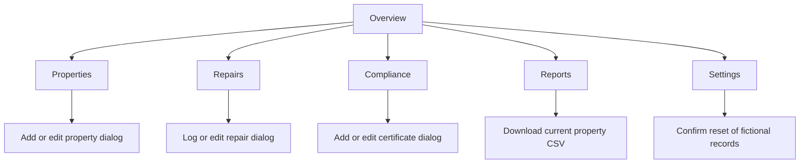

# UX design — PropertyFlow

## Problem, audience and value

A small property team can lose time switching between spreadsheets, repair messages and certificate folders. PropertyFlow brings related records into one fictional portfolio. Managers need quick summaries and exceptions; administrators need reliable entry and editing; maintenance coordinators need priorities and progress. Linking records reduces repeated address entry and prevents orphaned repairs. The prototype demonstrates this workflow, without claiming production security or legal compliance.

## User stories and requirements

| ID   | User need                                | Acceptance criterion                                                           | Implementation                    |
| ---- | ---------------------------------------- | ------------------------------------------------------------------------------ | --------------------------------- |
| US01 | Manager sees portfolio health            | Current count, occupancy, rent and urgent work agree with records              | Overview; metrics()               |
| US02 | Administrator finds a property           | Address/postcode search combines with status filter; clear restores rows       | Properties; filterProperties()    |
| US03 | Administrator maintains accurate records | Add/edit validates; duplicate blocked; linked deletion blocked                 | Property dialog; API validation   |
| US04 | Coordinator triages work                 | Create/edit property-linked repairs; filter priority/status; advance lifecycle | Repairs                           |
| US05 | Manager reviews certificates             | Real date boundaries, expiry ordering, status filtering and editing            | Compliance                        |
| US06 | Manager extracts information             | Current summaries and properly escaped property CSV                            | Reports                           |
| US07 | User controls demo data                  | Changes persist; confirmed reset restores starter records                      | Settings                          |
| US08 | Mobile user works on a small screen      | Navigation, forms and scrollable tables usable from 320px                      | Responsive shell                  |
| US09 | Keyboard user operates controls          | Skip link, labels, visible focus, trapped modal focus and Escape               | Native dialogs and event handlers |
| US10 | User recovers from failure               | Loading, readable error, retry and reset; no false successful save             | API and error panel               |

Functional requirements are the acceptance criteria above. Non-functional requirements: framework-free readable modules, no real personal data, no runtime dependencies, no page-wide overflow at required widths, explicit failure handling, modest assets and useful documentation. Accessibility follows WCAG 2.2 AA principles; an automated scan alone cannot establish conformance.

## Information architecture

The persistent sidebar supports recognition. Hash routes keep static hosting simple and browser history usable. Overview puts scale first, then attention, recent properties and quick actions. Tables retain consistent column meanings; certificate and repair records reference the property ID rather than copying the address.

## Design system

Deep navy #111c32 anchors navigation; #f5f7fb provides the canvas; white panels group content. Muted red #b93636 marks primary actions, green #176b50 indicates positive status and amber #875809 signals upcoming review. Text labels always accompany colour. The CSS defines colour, font, spacing, radius and shadow tokens and reuses button, field, panel and status classes. Arial/Helvetica/sans-serif works without external network requests. Regular controls have 44px minimum height; small notification dismiss controls meet a 24px target.

## Accessibility and responsive decisions

Semantic navigation/main/footer, one view h1, labelled native controls, aria-describedby field errors and a polite live region provide structure and feedback. Dialogs open with showModal(), block the background, wrap Tab/Shift+Tab and support Escape. Busy saves briefly disable dismissals until persistence completes, avoiding ambiguous partial actions. Focus returns to the opener where it survives, otherwise main receives focus. The sidebar is a mobile disclosure, with hidden links inert and Escape dismissal; it is not misrepresented as a modal.

Below 820px the sidebar becomes a disclosure. Cards collapse at smaller breakpoints, with one KPI column at 320px. Wide tables intentionally scroll inside labelled keyboard-focusable regions; the overall page does not scroll horizontally. A 320px viewport is also useful evidence for reflow but is not a substitute for real browser zoom or assistive-technology tests.

## Wireframes and actual implementation

[Wireframe](ux-wireframe.md) is explicitly retrospective. [Desktop screenshot](evidence/dashboard-1440.png) and [320px screenshot](evidence/dashboard-320.png) show the implemented hierarchy. See [evidence checklist](evidence-checklist.md) for story-to-image mapping. The chart area now shows status bars, not the supplied invented rent history; Settings was added as a sixth route.

## Compromises and future work

Native confirm prompts are used for destructive actions. Browser storage has no authentication or shared server history. Web Locks coordinate participating tabs where supported; fallback queuing only coordinates one tab. Two users editing the same field are not given a merge-conflict screen. Certificate status is a date workflow, never a legal judgement. Repair age is labelled unresolved; no unsupported contractual overdue deadline is invented. Recent activity is the genuine list of recently added properties, not a fabricated event feed. Screen-reader speech, real device interaction and assessor usability feedback still need human verification.
